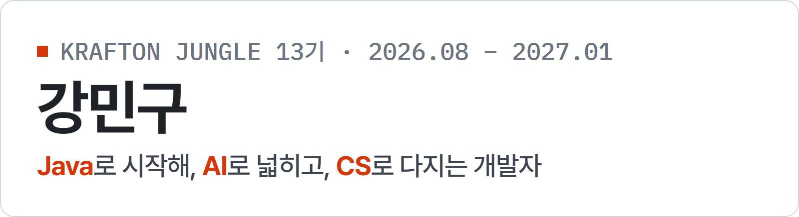
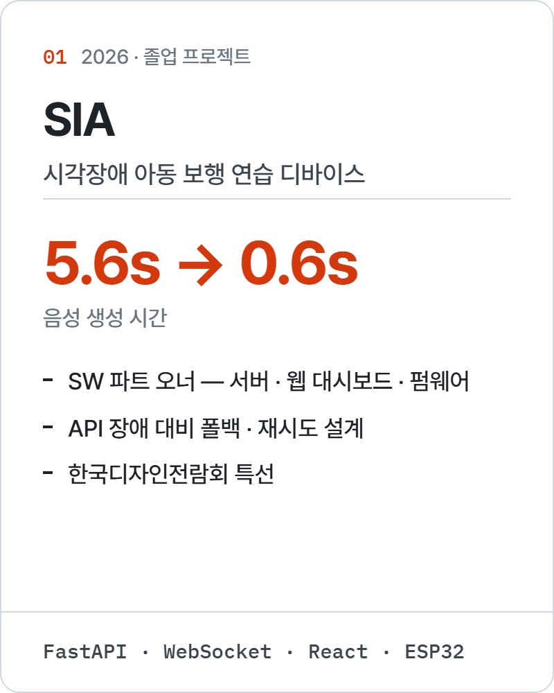
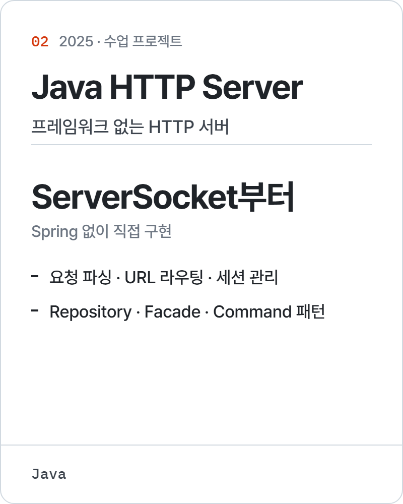
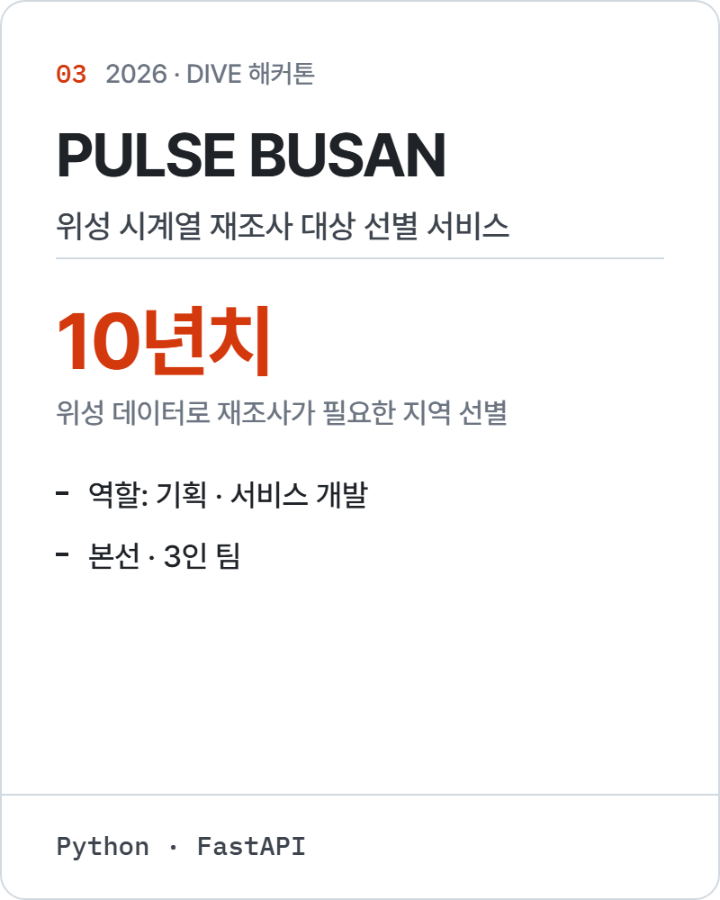

<picture>
  <source media="(prefers-color-scheme: dark)" srcset="assets/header-dark.png">
  
</picture>

Java로 클라이언트·서버 흐름과 객체지향 설계를 공부했고, AI를 활용해 하드웨어 연동·데이터 서비스로 개발 영역을 넓혔습니다. 
지금은 크래프톤 정글 13기에서 AI의 결과를 스스로 판단할 수 있는 CS 기본기를 쌓고 있습니다.

  <a href="https://github.com/pinn99k/cupid_project"><picture>
    <source media="(prefers-color-scheme: dark)" srcset="assets/card-sia-dark.png">
    
  </picture></a>
  <a href="https://github.com/pinn99k/java-http-server"><picture>
    <source media="(prefers-color-scheme: dark)" srcset="assets/card-java-http-server-dark.png">
    
  </picture></a>
  <a href="https://github.com/pinn99k/Dive2026-LoveDive"><picture>
    <source media="(prefers-color-scheme: dark)" srcset="assets/card-pulse-busan-dark.png">
    
  </picture></a>

**Now** — 크래프톤 정글 13기 · 자료구조부터 운영체제까지 C로 직접 구현하며 학습 중 → [jungle_pintos](https://github.com/pinn99k/jungle_pintos)

**Contact** — [minn90311@gmail.com](mailto:minn90311@gmail.com) · [velog.io/@pinn99u](https://velog.io/@pinn99u)
